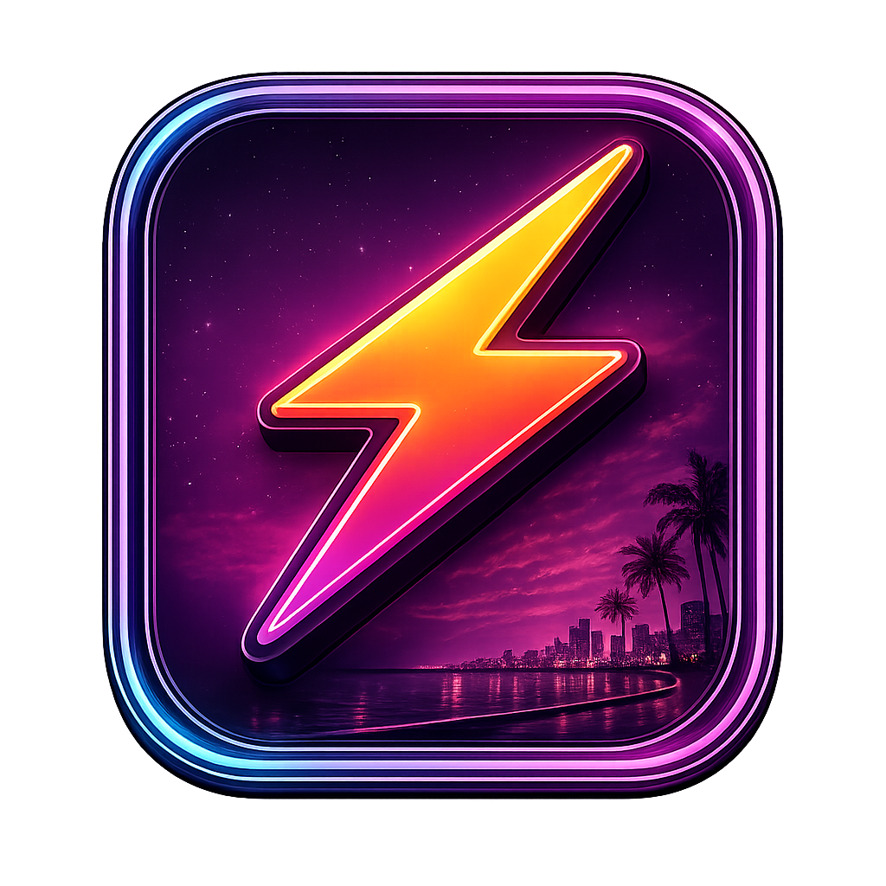
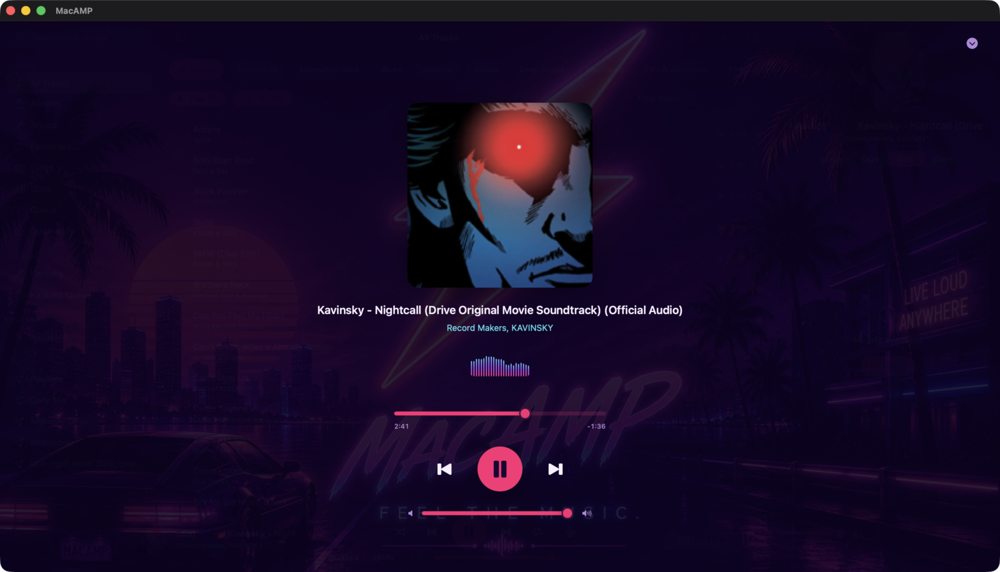
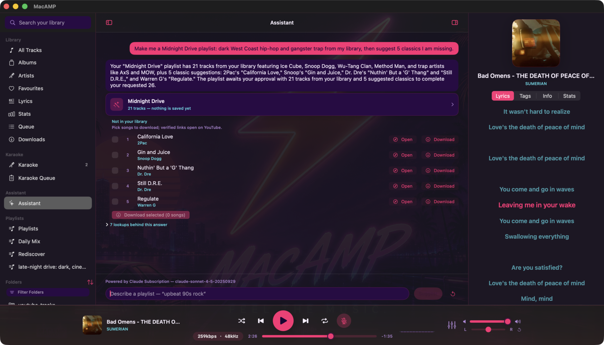
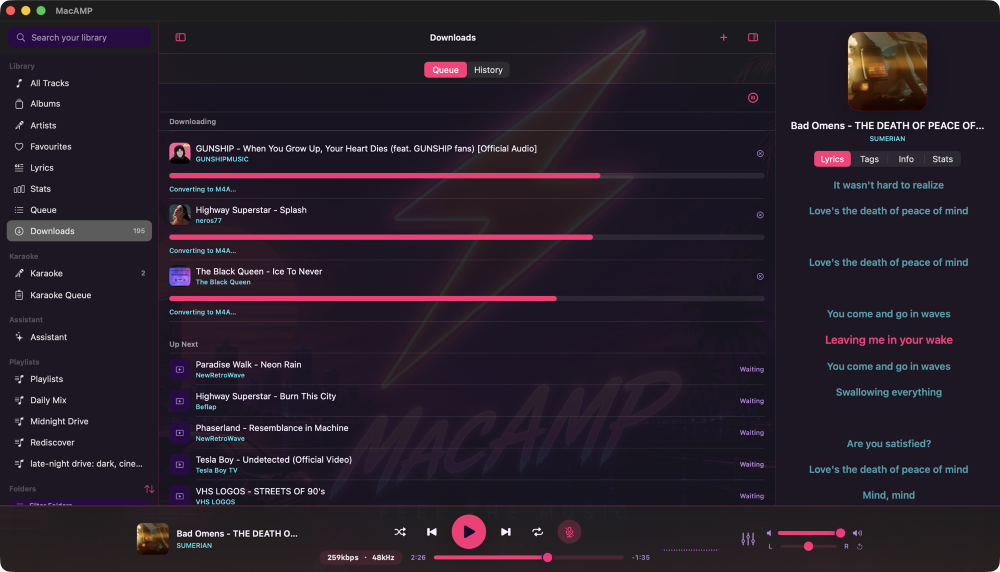
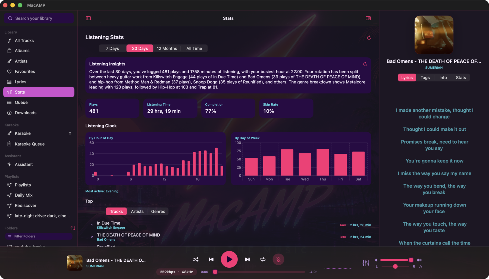
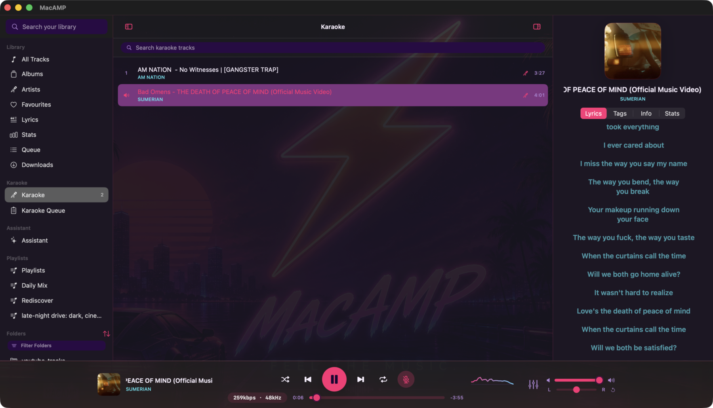

<div align="center">



# MacAMP

**A native music player for the music you own. Built for macOS, with neon to spare.**

[Website](https://macamp.si) · [Download](https://macamp.si/download/) · [User guide](https://docs.macamp.si/docs/) · [Developer guide](DEVELOPMENT.md)

[](https://github.com/airnayden/macamp/actions/workflows/ci.yml)


[](LICENSE)



</div>

---

MacAMP plays the files on your drive, from MP3 to 24-bit FLAC and DSD, and adds things other players don't: an AI assistant that builds playlists from your own library and fetches the songs you're missing, YouTube downloads, on-device karaoke, listening stats and synced lyrics. It's written in Swift 6 with SwiftUI on top of a real audio engine. No account, no ads, no tracking.

## Features

- **AI playlist assistant.** Describe a mood and it searches your library first, proposes a playlist you review before anything is saved, and suggests missing songs with verified YouTube links you can download in one click. Works with Claude, ChatGPT, OpenAI or a local [Ollama](https://ollama.com) server.
- **YouTube downloads.** Paste songs or whole playlists; MacAMP saves them as M4A, MP3, Opus or FLAC, up to four at a time, straight into your library.
- **Karaoke on your Mac.** A Mel-Band Roformer model removes the vocals from any track offline, with synced lyrics on screen.
- **Listening stats.** A listening clock, top tracks, artists and genres, and a replay heatmap of the parts you keep going back to.
- **Sound.** 10-band graphic EQ, parametric EQ with AutoEq headphone profiles, crossfeed, ReplayGain, gapless playback and a signal-path view.
- **Library.** Live folder watching, instant search, smart playlists, M3U/PLS/JSPF import and export, and safe tag editing.
- **Profiles.** Separate libraries, playlists and stats per person, with an optional PIN.
- **MCP server.** Let AI apps on your Mac, like Claude Desktop, search and play your library. Off by default.
- **Everywhere on the Mac.** Album-art theming, a menu-bar mini player, media keys and Control Center.

**Formats:** FLAC, ALAC, AAC/M4A, MP3, Opus, Ogg Vorbis, WavPack, Monkey's Audio, Musepack, WAV, AIFF, DSD (DSF/DFF) and tracker modules (MOD, XM, IT, S3M).

<table>
  <tr>
    <td></td>
    <td></td>
  </tr>
  <tr>
    <td></td>
    <td></td>
  </tr>
</table>

## Install

**macOS 14 Sonoma or later on Apple silicon** (Karaoke needs macOS 15 Sequoia). Get the latest version from **[macamp.si/download](https://macamp.si/download/)**, or install it from Terminal:

```sh
curl -fsSL https://downloads.macamp.si/install.sh | bash
```

The [installer](scripts/install.sh) checks the download's SHA-256, copies MacAMP into Applications and opens it.

MacAMP is distributed directly, not through the App Store, and updates itself with [Sparkle](https://sparkle-project.org). Until releases are notarized, macOS asks you to approve a downloaded DMG once (the Terminal install skips this): open **System Settings › Privacy & Security** and click **Open Anyway**. The [install guide](https://docs.macamp.si/docs/install/) walks through it.

**iPhone and iPad:** a beta built on the same core is in progress. See [`iOS/README.md`](iOS/README.md) for its status.

## Privacy

Playback, karaoke, stats and your library stay on your Mac. AI features are opt-in: with a local Ollama server nothing leaves your Mac, and with a cloud provider MacAMP shows exactly what may be shared before anything is sent. File paths, audio, artwork and lyrics are never sent to any model. Details: [AI features](https://docs.macamp.si/docs/intelligence/).

## Build from source

You need **Xcode 26**, [Tuist](https://tuist.dev) and [Mint](https://github.com/yonaskolb/Mint) (`brew install tuist mint`).

```sh
tuist install --force-resolved-versions
tuist generate --no-open
xcodebuild build -workspace MacAMP.xcworkspace -scheme macampMac \
  -destination 'platform=macOS,arch=arm64' CODE_SIGNING_ALLOWED=NO
```

Or use the all-in-one script, which also prepares the karaoke model:

```sh
scripts/build-macamp.sh               # downloads (~900 MB) and converts the model, then builds
scripts/build-macamp.sh --skip-model  # faster; everything works except Karaoke
```

The model isn't stored in this repository. The build downloads the original checkpoint from its author's Hugging Face repository and converts it to Core ML locally, which needs Python 3.12 via [uv](https://docs.astral.sh/uv/).

Tests, linting, CI and the architecture are covered in the **[developer guide](DEVELOPMENT.md)**.

## Project layout

| Path | What it is |
|---|---|
| [`PlayerCore/`](PlayerCore/README.md) | The shared Swift package: audio engine, DSP, persistence, services and view models. No AppKit or UIKit. |
| [`macOS/`](macOS/README.md) | The macOS app (`macampMac`): SwiftUI views, menus, downloads, MCP server, Sparkle. |
| [`iOS/`](iOS/README.md) | The iPhone and iPad app (`macampiOS`), in beta. |
| `AIConnectorKit/` | AI provider connectors (Claude, OpenAI, Ollama, subscriptions). |
| [`docs-site/`](docs-site/README.md) | The user guide at [docs.macamp.si](https://docs.macamp.si), built with Fumadocs. |
| `scripts/` | Build, release and CI guard scripts. |
| `tools/separation/` | Karaoke model download and Core ML conversion. |

## Contributing

Bug reports and ideas are welcome as issues. Before opening a pull request, please read the [developer guide](DEVELOPMENT.md), especially the audio-thread rules and the lint setup, and run the tests:

```sh
DEVELOPER_DIR=/Applications/Xcode.app/Contents/Developer swift test --no-parallel
mint run swiftformat . --lint && mint run swiftlint lint --strict
```

## Acknowledgments

MacAMP stands on great open-source work, including [SFBAudioEngine](https://github.com/sbooth/SFBAudioEngine), [GRDB.swift](https://github.com/groue/GRDB.swift), [Sparkle](https://github.com/sparkle-project/Sparkle), [projectM](https://github.com/projectM-visualizer/projectM), the [MCP Swift SDK](https://github.com/modelcontextprotocol/swift-sdk) and the Mel-Band Roformer vocal model by Kimberley Jensen. Full attribution and license texts: [acknowledgments](docs-site/content/docs/acknowledgments.mdx).

## Author

MacAMP is made by **Nayden Panchev** · [drpanchev.com](https://drpanchev.com) · [dently.si](https://dently.si) · [app.dentist](https://app.dentist) · [@airnayden](https://github.com/airnayden)

If MacAMP earns a spot in your Dock, you can [support it](https://macamp.si/support/).

## License

MacAMP is free software under the [GNU General Public License v3.0](LICENSE), with two additional terms in [`NOTICE`](NOTICE):

- **Keep it open.** You can use, study, change and share MacAMP. If you distribute a modified version or anything built on it, you must release its source code under the same license.
- **Give credit.** Keep the `NOTICE` file, and state in your project, and in its About or credits screen, that it's based on MacAMP by Nayden Panchev, with a link to this repository.
- **Use your own name.** The license doesn't cover the MacAMP name, logo or icon, so forks need their own.

Third-party components keep their own licenses (see [acknowledgments](docs-site/content/docs/acknowledgments.mdx)).
